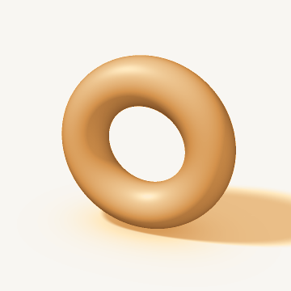

# Bending Without Tearing

Two small, dependency-free C++17 programs that deform one shape into another the way a topologist would — bending and stretching, but never tearing or gluing — and a paper that explains exactly what each program proves and what it only checks numerically.

| Program | Deformation | Output |
|---|---|---|
| [`src/circle_to_square.cpp`](src/circle_to_square.cpp) | circle → square | `circle_to_square.html` (animated SVG) |
| [`src/donut_to_mug.cpp`](src/donut_to_mug.cpp) | donut → coffee mug | `donut_to_mug.gif` and `donut_to_mug.html` |



## The idea

**Circle → square** is an explicit homeomorphism of the plane, the radial change of norm

```
F(p) = (‖p‖₂ / ‖p‖∞) · p
```

together with the straight-line deformation `H(p,t) = (1−t)·p + t·F(p)`. Every stage is a homeomorphism, so the curve never crosses itself. The corners of the square are invisible to topology.

**Donut → mug** has no closed formula. The program builds a one-parameter family of solids (signed distance functions, ray-marched for the animation) from an exact solid torus to a mug, and at each of 41 stages computes the Betti numbers of a voxel model from the Euler characteristic and connected-component counts. A donut and a mug are both "a ball with one handle", so every stage should have (b0, b1, b2) = (1, 1, 0), and it does.

## Build and run

Requires a C++17 compiler. No other libraries.

```bash
# GCC / MinGW / Clang
g++ -std=c++17 -O2 -static src/circle_to_square.cpp -o circle_to_square
g++ -std=c++17 -O2 -static src/donut_to_mug.cpp -o donut_to_mug

# Microsoft Visual C++ (Developer Command Prompt)
cl /EHsc /std:c++17 /O2 src\circle_to_square.cpp
cl /EHsc /std:c++17 /O2 src\donut_to_mug.cpp
```

Run from the repository root:

```bash
./circle_to_square      # or circle_to_square.exe on Windows
./donut_to_mug
```

Each program prints its checks, writes its output files into the current directory, and exits with status 0 if all checks passed (1 otherwise). On Windows the HTML page opens automatically in your default browser; elsewhere, open it yourself.

## The paper

[`paper/bending-without-tearing.pdf`](paper/bending-without-tearing.pdf) — *Bending Without Tearing: A topological account of two deformation programs: circle → square and donut → mug* (October 18, 2026).

It keeps proof and evidence apart:

- **Proved:** `F` is a homeomorphism and `H` an ambient isotopy; a dent is not a hole; the donut and the mug are homeomorphic; the voxel algorithm computes the exact Betti numbers of the cubical complex it builds.
- **Checked numerically:** the Betti numbers of all 41 stages (and of finer stage and voxel-size sweeps), plus control experiments whose outcomes are predicted by the Mayer–Vietoris sequence.
- **Not proved:** that every stage of the donut → mug family is a solid torus. The paper says what a proof would require.

## Repository layout

```
src/     the two C++ programs
paper/   the paper
docs/    preview image used in this README
```

## License

See [LICENSE](LICENSE).
